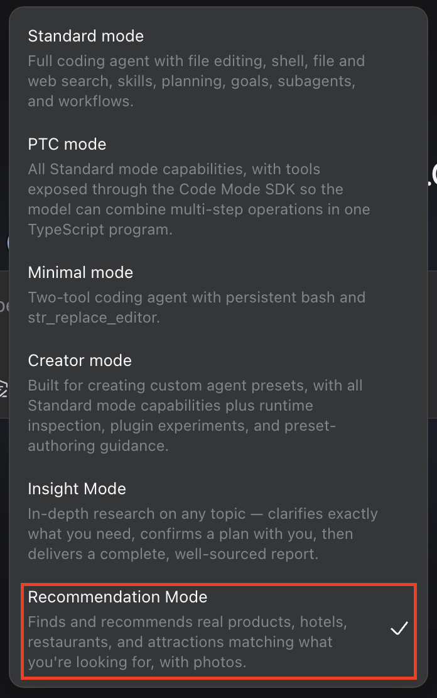
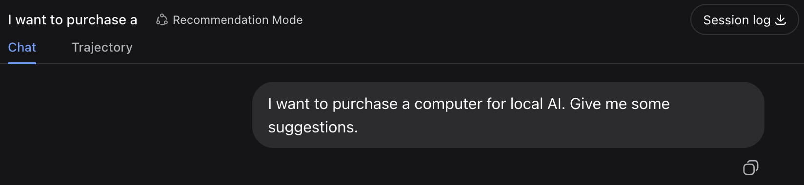
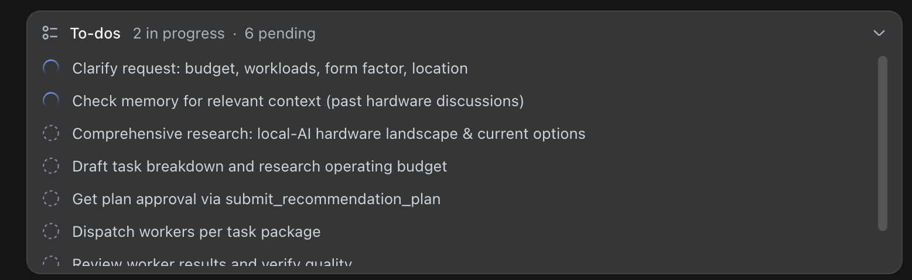
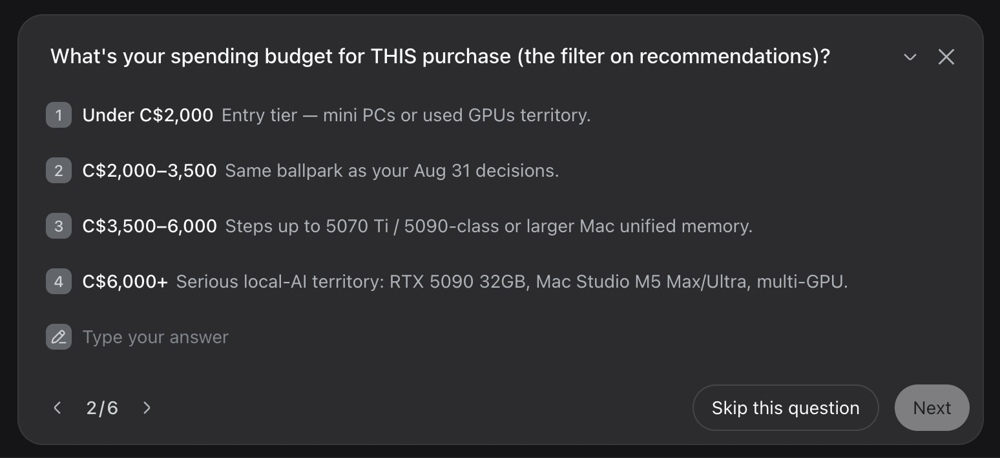
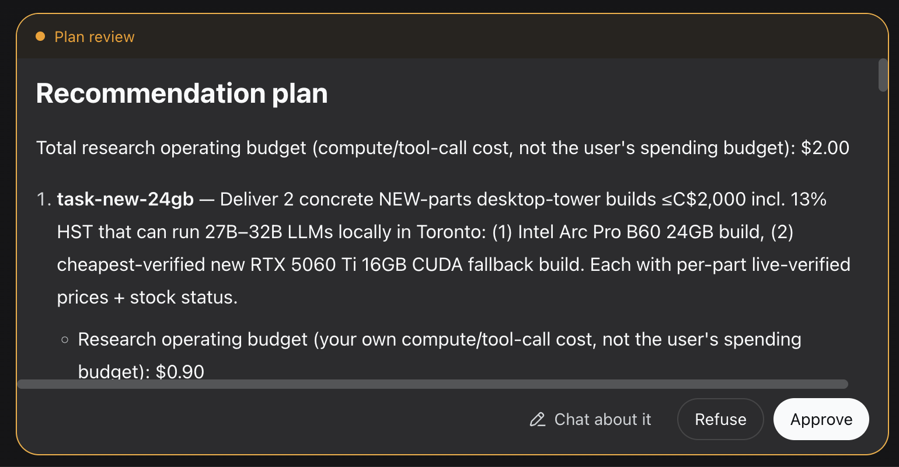
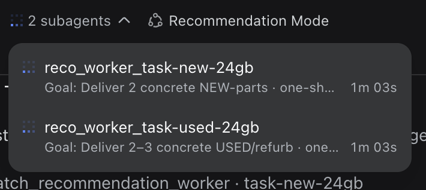
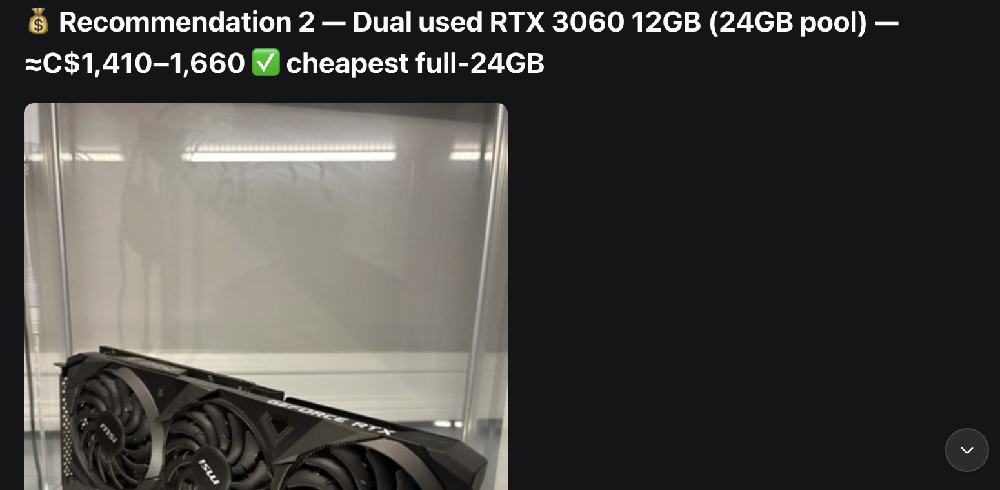

# DSH | dsh-plugin-recommendation-mode | Real product/hotel/restaurant/attraction recommendations, with real photos

Ask a general-purpose agent to "recommend some hotels" and you get a wall of text with no way to tell at a glance which option looks right. Recommendation Mode clarifies your filters, gets your approval on a plan and budget, dispatches workers that verify each option against its real listing page, and reports back with an actual photo per recommendation - not just a link.



## How it works

A real run - asking for a computer to run local AI models:

**1. Receive the task** - is this actually a recommendation request (products, hotels, restaurants, attractions), or should it decline and point elsewhere?



**2. List a todo checklist** up front, so progress is visible from the very start:



**3. Clarify** - concrete filter questions, one at a time: price budget, workloads, form factor, and its own operating budget (explicitly separate from your purchase budget). Can take several turns until the filters are precise:



**4. Comprehensive research** - the master does its own multi-angle `web_search` passes to work out the real categories and comparison angles before drafting anything.

**5. Draft a plan and submit for approval** via `submit_recommendation_plan` - **this blocks on your approval**; Refuse sends feedback back for revision, so this can take a few rounds too:



**6. Dispatch workers in parallel** via `dispatch_recommendation_worker`:



**7. Workers report back, master finalizes** - each worker fetches the real listing page for an option (not just a search snippet) to verify it and pick up a real photo before self-assessing; the master reviews every output and writes the final report with a real photo per item, never fabricated, never dropped just for lacking one:



Every price, stock count, and spec behind a run like this held up under independent re-verification against the live retailer pages afterward - down to "exactly 1 unit left at a specific store" matching exactly.

## How it integrates with DSH

A pure host-side plugin, architecturally identical to (but fully independent from) [`dsh-plugin-insight-mode`](https://github.com/ZG2017/dsh-plugin-insight-mode) - no shared runtime dependency. It registers its own identity directly as DSH's `deployment:persona` prompt section (`ctx.systemPrompt.section()` - the same mechanism `@deepseek-ai/dsh-persona` itself uses), so installing this plugin is enough on its own; no separate persona to hand-assemble. It also mounts `submit_recommendation_plan` and `dispatch_recommendation_worker` (spawns an isolated `spawn` subagent per task). The real-photo mechanism needs nothing image-specific: a worker's `web_fetch` call converts the listing page's HTML to markdown, which already renders `` tags as markdown image syntax - the worker just has to cite what it found.

## How this differs

No recommendation/shopping/travel-planning plugin currently exists in the DSH showcase category - this is an open niche, not a crowded one. It reuses Insight Mode's proven master/worker/approval-gate architecture, applied to option-finding with real photo evidence instead of open-ended research.

## Install

```sh
dsh plugin --profile web add github:ZG2017/dsh-plugin-recommendation-mode
```

The plugin supplies its own persona (no persona text to copy or hand-assemble), but DSH still needs a concrete preset **directory** to select in the picker - presets are directory-discovered, not plugin-registered, so there's no code hook for a plugin to create one for you. This package ships a ready-to-use one (also setting `tool-web`'s `fetch: true`, since DSH defaults that to `false` and workers need real page content, not just search snippets) - copy it into your preset root and restart:

```sh
cp -r ~/.dsh/profiles/web/node_modules/@gz2016/dsh-plugin-recommendation-mode/preset ~/.dsh/.agent-presets/recommendation
```

(Adjust the paths if you use a custom `$DSH_HOME` or profile name.) "Recommendation Mode" then appears in the preset picker.

## Known limitations

- The domain gate ("is this actually a recommendation request") is a persona instruction, not a code-enforced check - it can be misjudged.
- The operating budget is advisory: it rides in the worker's prompt, and nothing aborts a worker mid-flight for exceeding it. Actual-spend reporting needs a separate cost-tracking plugin providing a `costForSession` service.
- Approved-plan and retry-count state is in-memory per process, not durable across a restart.

---
*Unofficial project, independently developed and maintained by a community member. Not affiliated with or endorsed by DeepSeek.*
